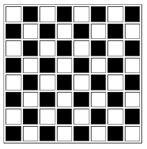
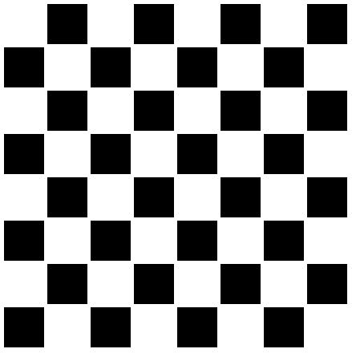

# Materi: HTML & CSS

- Membuat tampilan papan catur menggunakan table tags dan atributnya (*border, bgcolor, height, width*)

**Screenshot HTML (table)**

- Membuat tampilan papan catur menggunakan div tags dan css internal styling

**Screenshot CSS (div - css internal)**

